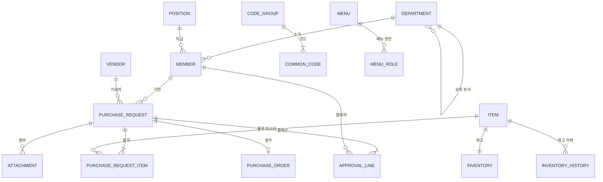

# ERD (테이블 설계)

GitHub에서 아래 그림이 바로 그려집니다(Mermaid). 모든 테이블에는 공통 컬럼 `created_at`, `updated_at`, `created_by`, `updated_by`가 있고 그림에서는 생략했습니다(`BaseEntity`).

## 1. 전체 관계도

## 2. 테이블 정의

### 조직

**department** (부서)

| 컬럼 | 타입 | 설명 |
|---|---|---|
| id | BIGINT PK | |
| code | VARCHAR(20) UNIQUE | 부서 코드 (예: `D100`) |
| name | VARCHAR(50) | 부서명 |
| parent_id | BIGINT FK → department | 상위 부서(본부), 본부면 NULL |
| use_yn | CHAR(1) | 사용 여부 |

**position** (직급)

| 컬럼 | 타입 | 설명 |
|---|---|---|
| id | BIGINT PK | |
| name | VARCHAR(20) | 사원, 대리, 과장, 차장, 부장 |
| rank_order | INT | 서열 (클수록 높음) |

**member** (사용자)

| 컬럼 | 타입 | 설명 |
|---|---|---|
| id | BIGINT PK | |
| login_id | VARCHAR(30) UNIQUE | 로그인 아이디 |
| password | VARCHAR(100) | BCrypt 해시 |
| name | VARCHAR(30) | 이름 |
| email | VARCHAR(100) | |
| department_id | BIGINT FK | 소속 부서 |
| position_id | BIGINT FK | 직급 |
| role | VARCHAR(20) | `EMPLOYEE`, `TEAM_LEADER`, `DEPT_HEAD`, `PURCHASING`, `ADMIN` |
| enabled | BOOLEAN | 사용중지면 로그인 불가 |

### 기준정보

**code_group / common_code** (공통코드)

| 테이블 | 컬럼 |
|---|---|
| code_group | group_code(PK, 예: `ITEM_CATEGORY`), name |
| common_code | id PK, group_code FK, code, name, sort_order, use_yn, UNIQUE(group_code, code) |

**item** (품목)

| 컬럼 | 타입 | 설명 |
|---|---|---|
| id | BIGINT PK | |
| code | VARCHAR(20) UNIQUE | 품목 코드 |
| name | VARCHAR(100) | 품목명 |
| category_code | VARCHAR(20) | 공통코드 `ITEM_CATEGORY` |
| unit_code | VARCHAR(20) | 공통코드 `UNIT` (EA, BOX 등) |
| standard_price | DECIMAL(15,0) | 기준 단가 |

**vendor** (거래처)

| 컬럼 | 타입 | 설명 |
|---|---|---|
| id | BIGINT PK | |
| biz_no | VARCHAR(10) UNIQUE | 사업자등록번호(숫자 10자리) |
| name | VARCHAR(100) | 상호 |
| ceo_name | VARCHAR(30) | 대표자 |
| status | VARCHAR(20) | `ACTIVE`, `SUSPENDED`(휴업), `CLOSED`(폐업), `UNKNOWN`(확인 안 됨) |
| status_checked_at | DATETIME | 마지막 상태 확인 시각 |

### 구매요청과 결재

**purchase_request** (구매요청서)

| 컬럼 | 타입 | 설명 |
|---|---|---|
| id | BIGINT PK | |
| request_no | VARCHAR(20) UNIQUE | 문서번호 `PR-202611-0001` |
| title | VARCHAR(200) | 제목 |
| reason | TEXT | 구매 사유 |
| requester_id | BIGINT FK → member | 기안자 |
| department_id | BIGINT FK → department | 기안 당시 부서 (나중에 부서를 옮겨도 유지) |
| vendor_id | BIGINT FK → vendor | 거래처 |
| total_amount | DECIMAL(15,0) | 합계 (서버 계산) |
| status | VARCHAR(20) | 3장 상태도 참고 |
| submitted_at | DATETIME | 상신 시각 |
| completed_at | DATETIME | 최종 승인·반려 시각 |
| version | BIGINT | **낙관적 락** (`@Version`) |

**purchase_request_item** (요청 품목)

| 컬럼 | 타입 | 설명 |
|---|---|---|
| id | BIGINT PK | |
| request_id | BIGINT FK | |
| item_id | BIGINT FK | |
| line_no | INT | 줄 번호 |
| quantity | INT | 수량 (1 이상) |
| unit_price | DECIMAL(15,0) | 요청 단가 |
| amount | DECIMAL(15,0) | 수량 × 단가 |

**attachment** (첨부파일)

| 컬럼 | 타입 | 설명 |
|---|---|---|
| id | BIGINT PK | |
| request_id | BIGINT FK | |
| original_name | VARCHAR(255) | 올린 파일 이름 |
| stored_name | VARCHAR(100) | 서버 저장 이름 (UUID) |
| size | BIGINT | 바이트 |
| content_type | VARCHAR(100) | |

**approval_line** (결재선 한 단계)

| 컬럼 | 타입 | 설명 |
|---|---|---|
| id | BIGINT PK | |
| request_id | BIGINT FK | |
| step_order | INT | 1, 2, 3 |
| approver_id | BIGINT FK → member | 결재자 |
| step_name | VARCHAR(20) | 팀장, 부서장, 구매팀장 |
| status | VARCHAR(20) | `WAITING`, `PENDING`, `APPROVED`, `REJECTED`, `CANCELED` |
| comment | VARCHAR(500) | 결재 의견 |
| processed_at | DATETIME | 처리 시각 |

### 발주와 재고

**purchase_order** (발주)

| 컬럼 | 타입 | 설명 |
|---|---|---|
| id | BIGINT PK | |
| order_no | VARCHAR(20) UNIQUE | `PO-202611-0001` |
| request_id | BIGINT FK UNIQUE | 요청서 하나에 발주 하나 |
| vendor_id | BIGINT FK | |
| status | VARCHAR(20) | `ORDERED`, `RECEIVED` |
| ordered_at / received_at | DATETIME | |

**inventory** (재고)

| 컬럼 | 타입 | 설명 |
|---|---|---|
| id | BIGINT PK | |
| item_id | BIGINT FK UNIQUE | 품목당 한 줄 |
| quantity | INT | 현재 수량 (0 이상) |

입고가 동시에 들어올 때는 이 행을 **비관적 락**(`SELECT ... FOR UPDATE`)으로 잠그고 바꿉니다.

**inventory_history** (재고 이력)

| 컬럼 | 타입 | 설명 |
|---|---|---|
| id | BIGINT PK | |
| item_id | BIGINT FK | |
| change_type | VARCHAR(10) | `IN`, `OUT`, `ADJUST` |
| change_qty | INT | 증감 수량 |
| after_qty | INT | 처리 후 수량 |
| order_id | BIGINT FK NULL | 관련 발주 |

### 운영

| 테이블 | 주요 컬럼 | 용도 |
|---|---|---|
| menu | id, name, url, parent_id, sort_order | 왼쪽 메뉴 |
| menu_role | menu_id, role | 메뉴별 볼 수 있는 역할 |
| monthly_purchase_stat | id, year_month, department_id, request_count, total_amount, UNIQUE(year_month, department_id) | 배치 집계 결과 |
| notification | id, member_id, message, link_url, read_yn | 결재 지연 알림 |
| audit_log | id, member_id, action, target_type, target_id, detail, ip, created_at | 누가 무엇을 바꿨는지 |
| error_log | id, request_uri, exception_class, message, created_at | 처리 못 한 예외 |

## 3. 설계하며 정한 것

- **기안 당시 부서를 요청서에 따로 저장합니다.** 사용자의 부서만 보면, 부서를 옮긴 뒤 옛 문서의 부서 통계가 바뀌어 버립니다.
- **단가를 요청 품목에 복사해 둡니다.** 품목 마스터의 기준 단가가 나중에 바뀌어도 이미 올린 문서의 금액은 그대로여야 하니까요.
- **결재선을 문서마다 행으로 저장합니다.** 조직도가 바뀌어도 이미 상신한 문서의 결재자는 바뀌지 않아야 합니다.
- **상태 값은 문자열 enum으로 저장합니다**(`@Enumerated(EnumType.STRING)`). 숫자(ORDINAL)로 저장하면 enum 순서를 바꾸는 순간 기존 데이터의 뜻이 바뀝니다.
- **삭제는 사용 여부(use_yn, enabled)로 막습니다.** 다른 문서가 참조하는 사용자·품목·거래처를 지우면 옛 문서가 깨지기 때문입니다.
