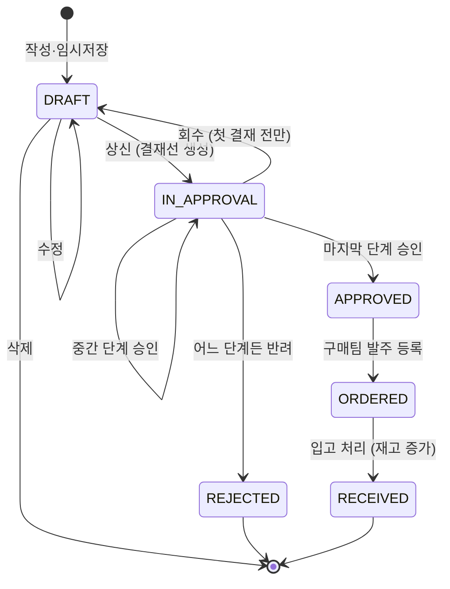
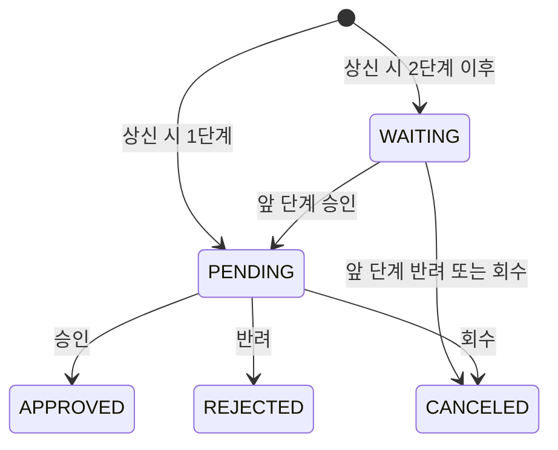

# 결재 상태도

## 1. 구매요청서 상태 (`purchase_request.status`)

| 상태 | 뜻 | 할 수 있는 일 |
|---|---|---|
| `DRAFT` | 임시저장 | 수정, 삭제, 상신 |
| `IN_APPROVAL` | 결재 중 | 결재자: 승인·반려 / 기안자: 회수(첫 결재 전) |
| `APPROVED` | 최종 승인 | 구매팀: 발주 등록 |
| `REJECTED` | 반려 | 조회만 (복사해서 새로 작성) |
| `ORDERED` | 발주 완료 | 구매팀: 입고 처리 |
| `RECEIVED` | 입고 완료 | 조회만 |

## 2. 결재선 한 단계 상태 (`approval_line.status`)

## 3. 예시: 600만 원 요청, 팀장 승인 → 부서장 승인 → 구매팀장 반려

| 순서 | 일 | 요청서 | 1단계 팀장 | 2단계 부서장 | 3단계 구매팀장 |
|---|---|---|---|---|---|
| 1 | 상신 | IN_APPROVAL | PENDING | WAITING | WAITING |
| 2 | 팀장 승인 | IN_APPROVAL | APPROVED | PENDING | WAITING |
| 3 | 부서장 승인 | IN_APPROVAL | APPROVED | APPROVED | PENDING |
| 4 | 구매팀장 반려 | **REJECTED** | APPROVED | APPROVED | REJECTED |

## 4. 코드에서 지킬 원칙

- 상태를 바꾸는 코드는 **엔티티 메서드 안에만** 둡니다(`request.submit()`, `line.approve()`). 서비스에서 `setStatus()`를 직접 부르지 않습니다. 그래야 "결재 중인 문서 수정" 같은 잘못된 전이를 한곳에서 막을 수 있어요.
- 허용되지 않는 전이는 `IllegalStateException` 대신 업무 예외(`BusinessException`, 에러 코드 포함)로 던지고 화면에 메시지를 보여 줍니다.
